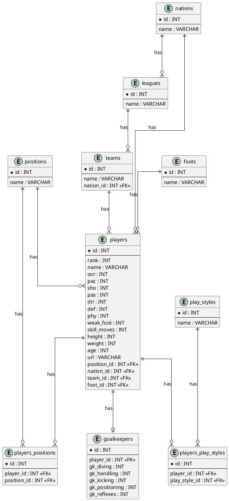

# Estándar para la Creación y Diseño de Tablas Relacionales

## 1. Objetivo

Establecer las reglas y convenciones que deben seguirse durante el diseño y creación de tablas en bases de datos relacionales, con el propósito de garantizar:

- Consistencia en la estructura de las bases de datos.
- Homogeneidad en los nombres de tablas y atributos.
- Correcta definición de claves primarias y foráneas.
- Integridad referencial entre entidades.
- Facilidad de mantenimiento y comprensión del modelo.
- Reducción de redundancia de datos.
- Cumplimiento de la Tercera Forma Normal (3FN).

Este estándar forma parte del sistema de gestión de calidad de software y debe ser aplicado durante el diseño de nuevos modelos de bases de datos.

---

## 2. Alcance

Este estándar aplica al diseño de:

- Tablas de entidades.
- Tablas catálogo.
- Tablas asociativas.
- Claves primarias.
- Claves foráneas.
- Atributos.
- Relaciones entre tablas.
- Tablas utilizadas para representar especializaciones de entidades.

---

## 3. Convención de nombres

Todos los nombres utilizados en la base de datos deben estar escritos en inglés.

Los nombres compuestos deben utilizar `snake_case`.

### 3.1. Nombres de tablas

Los nombres de las tablas deben cumplir las siguientes reglas:

1. Deben estar escritos en inglés.
2. Deben utilizar plural.
3. Deben utilizar `snake_case` cuando estén compuestos por varias palabras.
4. Deben representar claramente la entidad o conjunto de registros almacenados.

### Ejemplos

| Correcto | Incorrecto |
| --- | --- |
| `players` | `player` |
| `play_styles` | `PlayStyles` |
| `alternative_positions` | `alternativePositions` |
| `goalkeepers` | `goalkeeper` |

---

## 4. Claves primarias

Todas las tablas deben tener una clave primaria denominada `id`.

La clave primaria debe ser de tipo `INT`.

### Ejemplo

```sql
CREATE TABLE players (
    id INT PRIMARY KEY
);
```

No se deben utilizar los siguientes nombres para las claves primarias:

```text
player_id
players_id
id_player
```

El nombre estándar de la clave primaria será siempre:

```text
id
```

---

## 5. Claves foráneas

Las claves foráneas deben utilizar el nombre de la tabla referenciada en singular, seguido de `_id`.

La estructura será:

```text
<table_singular>_id
```

### Ejemplos

| Tabla referenciada | Clave foránea |
| --- | --- |
| `players` | `player_id` |
| `positions` | `position_id` |
| `play_styles` | `play_style_id` |
| `teams` | `team_id` |
| `nations` | `nation_id` |
| `foots` | `foot_id` |

### Ejemplo

```sql
CREATE TABLE players (
    id INT PRIMARY KEY,
    position_id INT,
    FOREIGN KEY (position_id) REFERENCES positions(id)
);
```

---

## 6. Atributos

Los nombres de los atributos deben:

- Estar escritos en inglés.
- Utilizar `snake_case`.
- Ser descriptivos.
- Representar una única propiedad.
- Evitar abreviaciones innecesarias.
- Utilizar un tipo de dato apropiado.

### Ejemplos

```text
name
weak_foot
skill_moves
height
weight
gk_diving
gk_handling
```

Se deben evitar nombres ambiguos como:

```text
data
value
info
type
attribute
```

cuando no permitan identificar claramente la información almacenada.

---

## 7. Tipos de datos

Los tipos de datos deben seleccionarse de acuerdo con la naturaleza del atributo.

| Tipo de información | Tipo recomendado |
| --- | --- |
| Identificadores | `INT` |
| Números enteros | `INT` |
| Texto corto | `VARCHAR` |
| Texto largo | `TEXT` |
| Fechas | `DATE` |
| Fecha y hora | `DATETIME` / `TIMESTAMP` |
| Valores booleanos | `BOOLEAN` |
| Valores decimales | `DECIMAL` |

La longitud de los campos `VARCHAR` debe definirse de acuerdo con los requisitos del sistema.

---

## 8. Relaciones uno a muchos

Las relaciones uno a muchos se representan colocando la clave foránea en la tabla correspondiente al lado "muchos" de la relación.

Por ejemplo:

```text
positions 1 ---- N players
```

Una posición puede estar asociada con múltiples jugadores, mientras que cada jugador tiene una posición principal.

La relación se implementa mediante:

```text
players
-------
id
name
position_id
```

Donde:

```text
players.position_id -> positions.id
```

### Representación PlantUML

```plantuml
positions ||--o{ players : "has"
```

---

## 9. Relaciones muchos a muchos

Las relaciones muchos a muchos deben implementarse mediante una tabla asociativa.

No se deben almacenar múltiples valores dentro de una única columna para representar una relación N:M.

Por ejemplo:

```text
players N ---- M positions
```

Debe resolverse mediante:

```text
players_positions
-----------------
id
player_id
position_id
```

### Representación PlantUML

```plantuml
players ||--o{ players_positions : "has"
positions ||--o{ players_positions : "has"
```

---

## 10. Tablas asociativas

Las tablas asociativas deben nombrarse concatenando los nombres de las tablas participantes en la relación mediante `_`.

La estructura será:

```text
<table_1>_<table_2>
```

Los nombres de las tablas originales deben mantenerse en plural.

### Ejemplos

Para la relación entre `players` y `positions`:

```text
players_positions
```

Para la relación entre `players` y `play_styles`:

```text
players_play_styles
```

### Ejemplo

```text
players_play_styles
-------------------
id
player_id
play_style_id
```

Las claves foráneas deben seguir la convención establecida:

```text
player_id -> players.id
play_style_id -> play_styles.id
```

---

## 11. Relaciones uno a uno

Las relaciones uno a uno pueden utilizarse para representar información especializada de una entidad.

Por ejemplo, los atributos específicos de los porteros pueden separarse de la tabla `players`.

La estructura será:

```text
players 1 ---- 0..1 goalkeepers
```

La tabla `goalkeepers` contiene:

```text
goalkeepers
-----------
id
player_id
gk_diving
gk_handling
gk_kicking
gk_positioning
gk_reflexes
```

### Representación PlantUML

```plantuml
players ||--o| goalkeepers : "has"
```

La relación es opcional del lado de `goalkeepers`, ya que no todos los jugadores necesariamente tendrán atributos específicos de portero.

---

## 12. Tablas catálogo

Cuando un atributo contiene valores reutilizables y controlados, se debe evaluar la creación de una tabla catálogo.

Por ejemplo, para representar el pie preferido:

```text
foots
-----
id
name
```

La tabla `players` tendrá:

```text
foot_id
```

La relación será:

```text
players.foot_id -> foots.id
```

### Representación PlantUML

```plantuml
foots ||--o{ players : "has"
```

Esto permite evitar inconsistencias como:

```text
Left
left
LEFT
L
Left Foot
```

---

## 13. Normalización

El diseño de las tablas debe cumplir, como mínimo, con la Tercera Forma Normal (3FN).

La normalización tiene como objetivo reducir la redundancia y evitar anomalías de inserción, actualización y eliminación.

### 13.1. Primera Forma Normal

Cada atributo debe contener un único valor atómico.

No se deben almacenar múltiples valores dentro de una misma columna.

### Incorrecto

```text
player_id | alternative_positions
----------|----------------------
1         | ST, CF, LW
```

### Correcto

```text
players_positions
-----------------
id
player_id
position_id
```

---

### 13.2. Segunda Forma Normal

Todos los atributos no clave deben depender completamente de la clave primaria.

Se deben evitar dependencias parciales.

En particular, las tablas asociativas deben analizarse para determinar que sus atributos dependan de la relación representada.

---

### 13.3. Tercera Forma Normal

Los atributos no clave no deben depender de otros atributos no clave.

### Incorrecto

```text
players
-------
id
name
team_id
team_name
```

En este caso, `team_name` depende de `team_id` y no directamente de `players.id`.

### Correcto

```text
teams
-----
id
name
```

Y:

```text
players
-------
id
name
team_id
```

De esta manera:

```text
players.team_id -> teams.id
```

La información de los equipos se almacena únicamente en `teams`.

---

## 14. Integridad referencial

Toda clave foránea debe hacer referencia a una clave primaria existente.

Por ejemplo:

```text
players.position_id
        |
        v
positions.id
```

Las relaciones deben implementarse mediante restricciones `FOREIGN KEY`.

### Ejemplo

```sql
FOREIGN KEY (position_id)
    REFERENCES positions(id)
```

No se deben crear claves foráneas que no representen una relación conceptual entre las entidades.

---

## 15. Reglas para evitar redundancia

Antes de agregar un atributo a una tabla se deben realizar las siguientes preguntas:

1. ¿El atributo pertenece directamente a la entidad?
2. ¿El atributo depende de la clave primaria?
3. ¿El atributo podría pertenecer a otra entidad?
4. ¿El atributo puede contener múltiples valores?
5. ¿El atributo representa un catálogo reutilizable?
6. ¿El atributo genera redundancia si se almacena en esta tabla?

Si un atributo representa una entidad independiente, un catálogo o una relación N:M, se debe evaluar la creación de una tabla independiente.

---

## 16. Ejemplo del modelo normalizado

El modelo utilizado como referencia puede estructurarse de la siguiente manera:

```text
players
├── position_id -> positions.id
├── nation_id -> nations.id
├── team_id -> teams.id
└── foot_id -> foots.id

teams
└── nation_id -> nations.id

players_positions
├── player_id -> players.id
└── position_id -> positions.id

players_play_styles
├── player_id -> players.id
└── play_style_id -> play_styles.id

goalkeepers
└── player_id -> players.id
```

Las relaciones principales son:

```text
nations 1 ---- N teams
nations 1 ---- N players
positions 1 ---- N players
teams 1 ---- N players
foots 1 ---- N players

players N ---- M positions
players N ---- M play_styles

players 1 ---- 0..1 goalkeepers
```

---

## 17. Diagrama de referencia

El siguiente diagrama representa un modelo que cumple las convenciones establecidas:



---

## 18. Reglas de validación

Antes de aprobar un modelo de base de datos, se debe verificar el siguiente checklist:

| Regla | Criterio |
| --- | --- |
| Idioma | Las tablas y atributos están en inglés |
| Tablas | Los nombres de las tablas están en plural |
| Formato | Se utiliza `snake_case` |
| Clave primaria | Todas las tablas tienen `id` |
| Tipo de PK | Todas las claves primarias son `INT` |
| Claves foráneas | Utilizan `<table_singular>_id` |
| Relaciones 1:N | La FK está ubicada en el lado N |
| Relaciones N:M | Utilizan una tabla asociativa |
| Tablas asociativas | Siguen el formato `<table1>_<table2>` |
| Integridad | Las FK referencian PK existentes |
| 1FN | No existen atributos multivaluados |
| 2FN | No existen dependencias parciales |
| 3FN | No existen dependencias transitivas |
| Redundancia | Se evita almacenar información duplicada |
| Catálogos | Los valores reutilizables se normalizan cuando corresponde |

---

## 19. Control de cambios

Cualquier modificación a este estándar debe ser revisada antes de su adopción en nuevos modelos de datos.

Las modificaciones deben evaluar como mínimo:

- Impacto sobre modelos existentes.
- Compatibilidad con las bases de datos actuales.
- Consistencia de las convenciones de nomenclatura.
- Impacto sobre la integridad referencial.
- Impacto sobre la normalización.
- Necesidad de migraciones de datos.

Las excepciones a este estándar deben estar documentadas y justificadas técnicamente.
